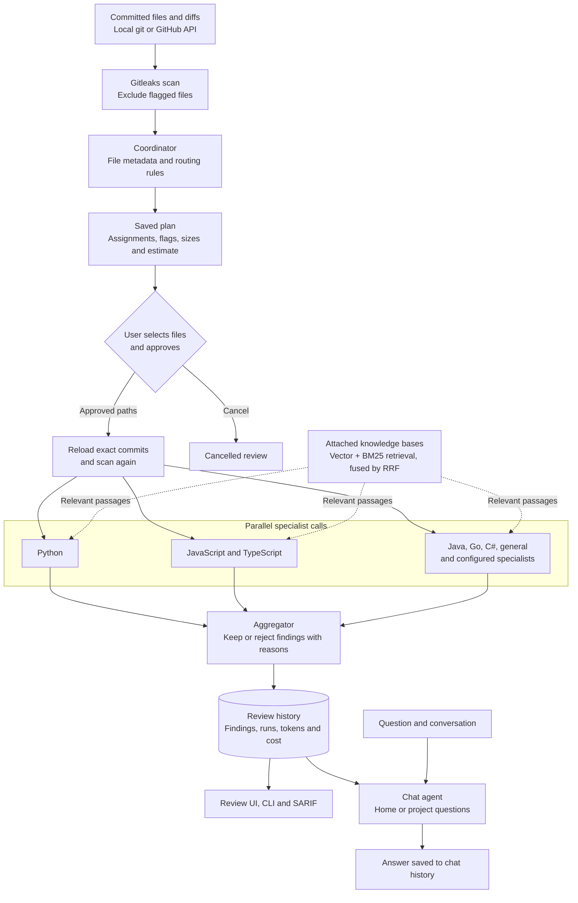
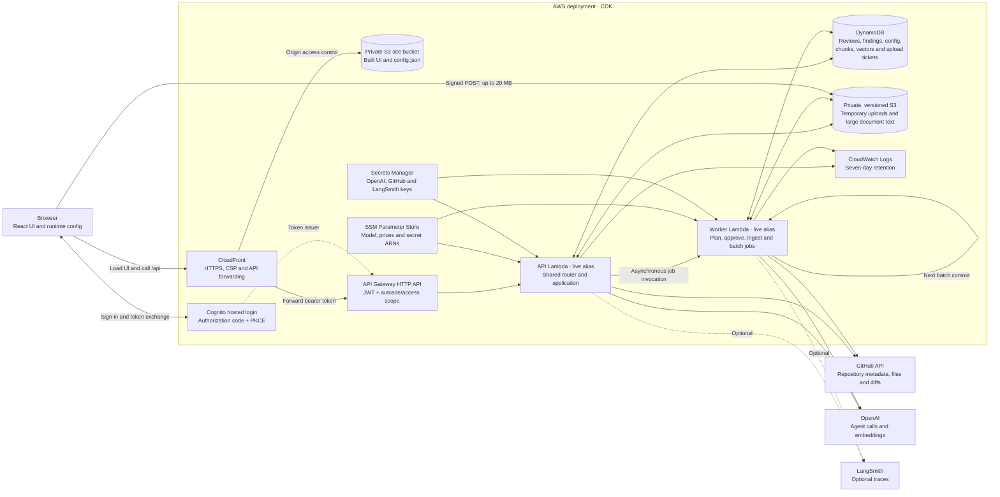
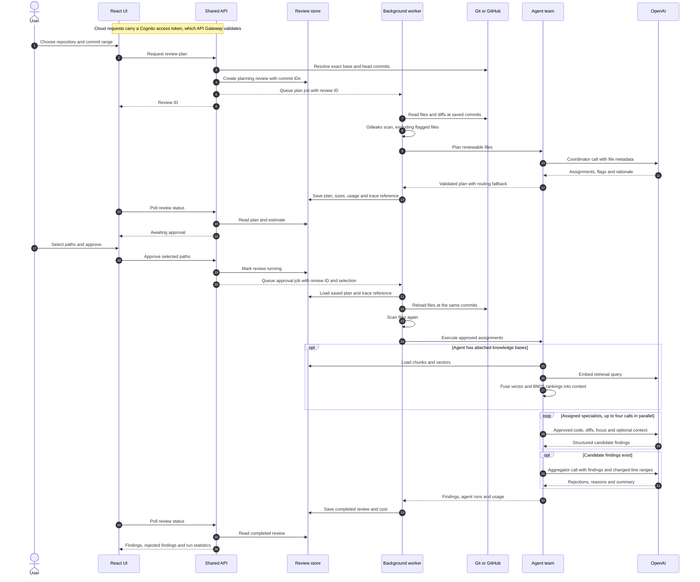
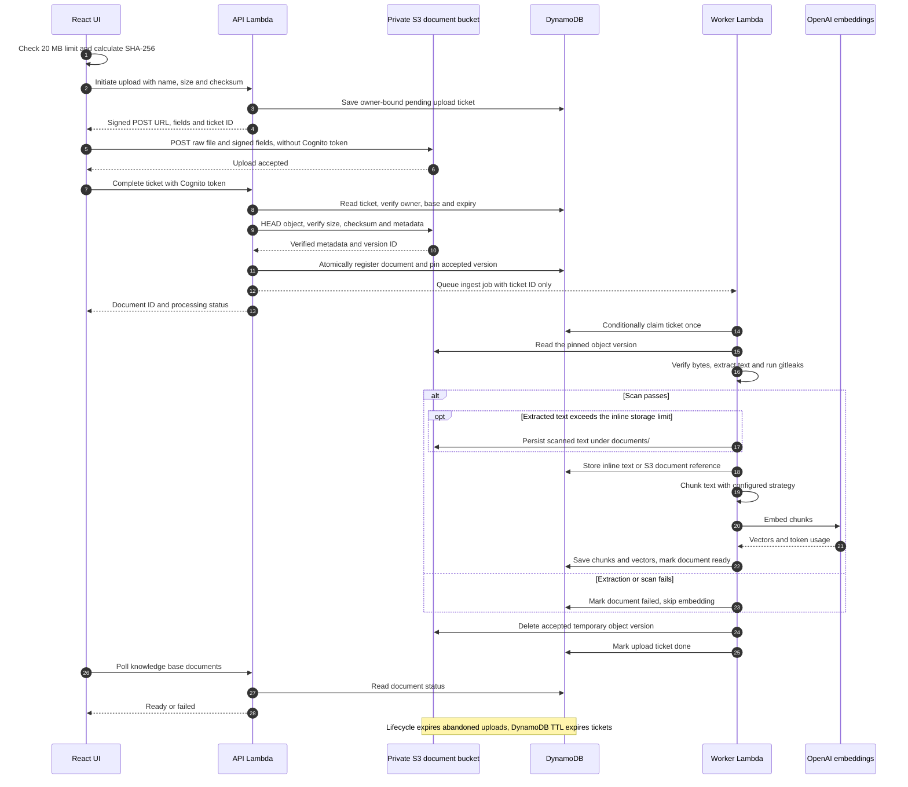

# Review Crew

A code reviewer for your git repositories, running locally or on AWS. A small team of AI agents reviews a commit range, you approve which files the specialists receive, and every review is saved for browsing, querying and chat.

- **Agent team:** a coordinator assigns changed files to language specialists (Python, JavaScript, TypeScript, Java, Go, C#, and a general catch-all). They review in parallel, and an aggregator keeps or rejects their findings. Fixes come back as diffs with line numbers.
- **Approval first:** rules flag files that rarely hold defects (lockfiles, build output, IDE settings, minified bundles). The coordinator uses file metadata to plan assignments; that model call uses tokens. You then select files and approve the estimated specialist review cost before source code reaches the specialists.
- **Storage and privacy:** local mode uses SQLite; AWS uses DynamoDB and private S3 storage. Reviewed source files and diffs are read from git or GitHub when needed, rather than saved as review payloads. Gitleaks scans review files before model use; optional LangSmith traces can contain scanned prompts, code and replies. Uploaded knowledge documents have their own storage flow below.
- **Small:** Python 3.12+ with a standard-library core and optional PDF/AWS dependencies. The React web UI is prebuilt, so no Node is needed to run it locally.

## Architecture

### Agent team

[`Team`](autosde/team.py) orchestrates the coordinator, parallel specialists and aggregator as [LangGraph](https://langchain-ai.github.io/langgraph/) graphs, through the shared model adapter. Planning is a one-node coordinator graph; after approval, the review graph fans out to the assigned specialists with `Send` and then runs the aggregator. The two graphs stay separate because approval can happen in another process (a separate Lambda in AWS), so no checkpointer is needed: the plan is saved with the review. Models, prompts, file extensions and attached knowledge bases are configurable per agent. The specialist pool runs up to four calls concurrently by default; additional specialists can be configured. The aggregator receives candidate findings and changed-line ranges, and is skipped when there are no findings.



Coordinator, specialist, aggregator and chat calls use OpenAI. Optional LangSmith tracing follows the review across planning and approval. If coordinator planning fails or leaves files unassigned, extension-based routing fills the gaps. Retrieval failures allow the review to continue without reference passages.

### Deployment

The React UI and [`shared API router`](autosde/api.py) serve both modes. Locally, `autosde serve` serves the built UI and API with localhost, same-origin and per-start token checks; background jobs run on threads and data lives in SQLite. AWS uses the same application code with cloud storage adapters and asynchronous worker invocations:



AWS accepts GitHub repositories and does not scan local folders. API and worker Lambdas share one packaged runtime; the API has a 28-second timeout and the worker a 14-minute timeout. Batches process one commit per worker invocation before scheduling the next. S3 buckets and DynamoDB are retained, and permissions are scoped to the application's resources. See the [deployment guide](docs/aws/DEPLOYMENT.md) for resource definitions and publishing steps.

### Review data flow

This is the web review workflow; in local mode, worker invocations become background threads and DynamoDB becomes SQLite. Planning and approval can run in separate processes because the saved plan includes commit IDs and file-size estimates, without retaining source contents between jobs.



The store retains review metadata and findings, which can quote code, rather than copies of the reviewed source files. Opening the Changed files view fetches the diff again from the repository. Enabled LangSmith traces are a separate destination for scanned model inputs and outputs.

### Knowledge upload data flow

Cloud uploads bypass the API's JSON payload limit. The authenticated API issues a ten-minute signed S3 form bound to the key, exact size, SHA-256 checksum and encryption. The completion ticket is bound to the signed-in user and knowledge base. Local uploads send their bytes to the local API and use the same extraction, scanning, chunking and embedding pipeline.



Repeated completion requests reuse the registered document, and the worker's conditional claim prevents duplicate ingestion. The accepted S3 version is pinned so a later overwrite cannot change the file being processed. Scanned document text, chunks and vectors are retained for retrieval; the raw staging upload is removed after processing. See [RAG details](docs/RAG.md) for chunking and retrieval settings.

## Quick start

```sh
git clone <this repository> autosde && cd autosde
brew install gitleaks              # or set AUTOSDE_GITLEAKS=/path/to/gitleaks
export OPENAI_API_KEY=...          # read from the environment, never stored
pip install -e .                   # installs LangGraph and adds the `autosde` command
pip install -e '.[pdf]'            # optional: PDF uploads to knowledge bases (pypdf)
autosde serve                      # open http://127.0.0.1:8765/
```

## The web app

- **Sidebar:** your repositories, found under your home folder. **Recent** lists reviewed projects, **Available** lists the rest, and one search box filters both. Folders macOS hasn't approved for your terminal are hidden; turn on **Settings → Show blocked folders** to see them. ☰ collapses the sidebar.
- **Home:** a chat about all your projects (branches, recent commits, file types and review history), next to your projects and recent reviews.
- **Project page:** four panels. On the left, pick a commit range (**From** is the newer end, **To** lists only older commits) and chat about the project's review history. On the right, its reviews and, if enabled, the agents that ran. Drag the dividers to resize, and use ⤢ to make any panel full screen.
- **GitHub repositories:** **+ Add GitHub repository** in the sidebar adds `owner/name` (or its URL). Nothing is cloned: branches, commits, diffs and file contents are read from the GitHub API. Requests go through the `gh` CLI when it's logged in, so private repositories work and Review Crew never sees a token; without `gh`, public repositories are read anonymously (about 60 requests an hour).
- **History batches:** on any repository page, the **History batch** tab reviews many commits in one approved run: every commit, merge commits only (one per merged PR), every Nth commit, or the latest N. Planning is local and free and shows each commit with an estimate; you approve once with a cost cap, and reviews run one at a time in the background with progress and Cancel.
- **Review page:** the plan with a checkbox per file and an estimated cost; after approval, findings with their diffs, the findings the aggregator rejected and why, and **Changed files**: every file in the range with its diff, five lines of context around each change, and the rest folded (expand 20 lines at a time or all). Diffs are read from the repository when you open them; the database stores no source code.
- **Knowledge:** create knowledge bases, upload documents (PDF, Markdown, text, code, HTML, JSON, CSV, .docx), inspect their chunks, tune the chunking and retrieval strategy, and test retrieval. See [docs/RAG.md](docs/RAG.md).
- **Agents:** enable specialists, set file extensions, pick each agent's model from those your key can use, edit every prompt, and see run statistics.
- **Settings:** theme (Light, Dark, Dracula), blocked folders, and whether agent runs appear on project and review pages.

Pages and selections have bookmarkable URLs: `#/agents/python`, `#/knowledge/1`, `#/settings`, `#/review/3`, and `#/project/1`. Repository pages use `#/repo?path=…` with a URL-encoded absolute path. Copy the address bar to reopen the same view; refresh and browser Back/Forward preserve navigation. Home project names and review numbers are links you can open in another tab. These links refer to data on this local Review Crew instance.

Only committed history is reviewed; uncommitted edits are ignored.

## Help, videos and the first-visit tour

The **Help** page has three short videos (running a review, configuring agents, settings and layout) and answers to common questions. On a first visit a short walkthrough points out the main areas; **Skip tour** or **Done** hides it for good in that browser, and **Show the tour again** (Help or Settings) replays it.

The videos are recorded with Playwright against a demo server with a sample repository and a scripted model, so recordings never show your projects or settings and cost nothing:

```sh
cd frontend
npm run build
npm run record-docs -- --gitleaks "$(command -v gitleaks)"   # writes src/docs/*.webm and *.jpg
npm run build                                                # bundles the new videos
```

## The command line

```sh
autosde review ~/code/calculator main..HEAD     # A..B, A.. (to HEAD) or one commit
autosde projects                                # reviewed projects
autosde reviews calculator                      # reviews for one project (id, name or path)
autosde show 3                                  # one review: agents, findings, limitations
autosde show 3 --format sarif --output autosde.sarif   # for VS Code's SARIF Viewer or GitHub
autosde agents calculator                       # which agents ran against a project
```

`review` prints the plan with `[x]`/`[ ]` marks, flag reasons and an estimated cost, then asks `[y]es / [a]ll, including flagged / [N]o`. Use `--yes` to approve as proposed, or `--include-flagged` / `--include PATH` to add flagged files.

## Configuration

| Variable | Default |
| --- | --- |
| `OPENAI_API_KEY` | required for reviews and chat |
| `AUTOSDE_MODEL` | `gpt-6-luna` (each agent can override it on the Agents page) |
| `AUTOSDE_INPUT_PRICE`, `AUTOSDE_OUTPUT_PRICE` | `0.10`, `0.50` USD per 1M tokens, for cost estimates |
| `AUTOSDE_REASONING_EFFORT` | `low` (`none` to omit; only sent to reasoning models) |
| `AUTOSDE_HOME` | `~/.autosde` (holds `autosde.db`, mode 0600) |
| `AUTOSDE_DB` | `$AUTOSDE_HOME/autosde.db` |
| `AUTOSDE_GITLEAKS` | `gitleaks` on `PATH` |
| `AUTOSDE_SECRET_ID`, `AUTOSDE_SECRET_PROFILE`, `AUTOSDE_SECRET_REGION` | unset; optionally read the OpenAI key from AWS Secrets Manager (`pip install -e '.[aws]'`) |
| `LANGSMITH_API_KEY`, `LANGSMITH_WORKSPACE_ID` | unset; see LangSmith tracing |

Agent settings (enabled specialists, extensions, models, tracing) are saved in `autosde/prompts/agents.json`, next to the prompts.

## Knowledge bases (RAG)

Attach knowledge bases to agents on the Agents page, and each specialist receives the passages most relevant to its changed lines, and the chat agent the passages relevant to your question. Documents are gitleaks-scanned, chunked by structure (headings, paragraphs, code definitions) with overlap, embedded with `text-embedding-3-small` at 512 dimensions, and stored in the local database. Retrieval is hybrid: vector similarity and BM25 keyword search fused with reciprocal rank fusion. The full strategy is in [docs/RAG.md](docs/RAG.md).

## LangSmith tracing

Turn it on from the Agents page and export `LANGSMITH_API_KEY` before starting Review Crew. Each review becomes one trace with a child run per agent call, containing the full prompt, the reviewed code and the reply. Untick "Trace this agent" to leave an agent out. Text gitleaks flags is withheld.

## Data

The database stores projects, reviews (range, status, tokens, cost), one row per agent call (agent, model, files, status, time, tokens), findings (file, lines, severity, title, description, fix, kept or rejected), chat history, and knowledge base documents with their chunks and embeddings. Query it with the CLI, the web app, the notebook, or `sqlite3 ~/.autosde/autosde.db`.

## Developing

Prompts live in `autosde/prompts/` and are re-read on every call. `notebooks/team.ipynb` runs a free scripted team, then an opt-in paid review.

```sh
python3 -m unittest discover -s tests -t tests   # no network or API key needed
```

The frontend is in `frontend/` (Vite + React). The built UI is committed in `autosde/static/`. After UI changes:

```sh
cd frontend && npm install && npm run build   # writes autosde/static/
npm run dev                                   # live reload; proxies /api to `autosde serve` on :8765
```

For frontend cloud login and deployment-time configuration, see [Frontend runtime configuration](docs/aws/FRONTEND.md). The bundled config keeps local mode as the default.

AWS deployment files are in [`infrastructure/`](infrastructure/). See the [deployment and review guide](docs/aws/DEPLOYMENT.md) for build, synth, diff, required parameters, and separately approved publishing.
