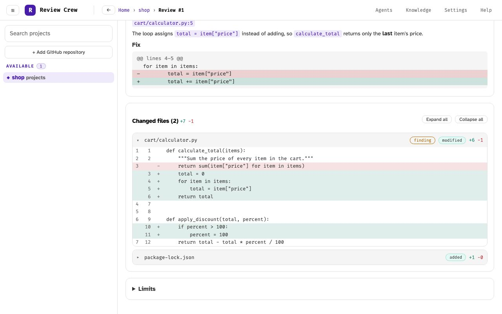
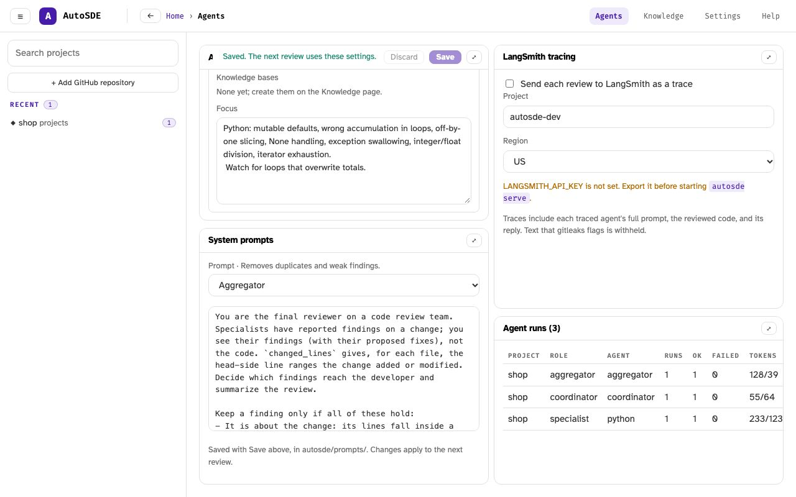
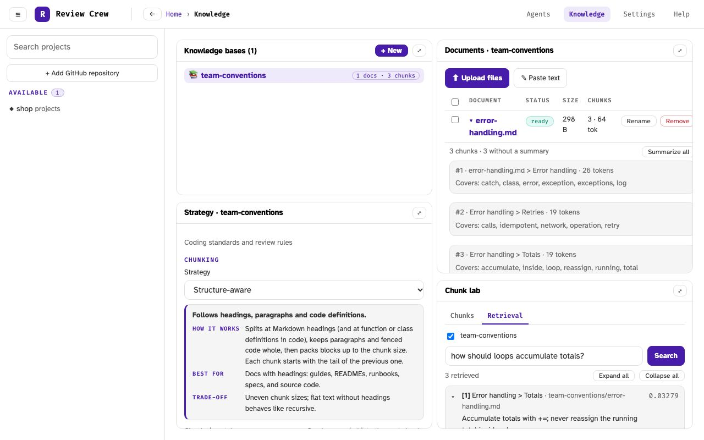
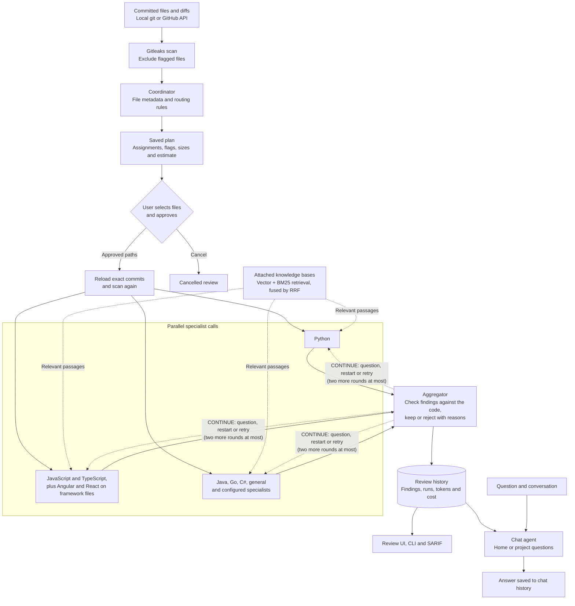
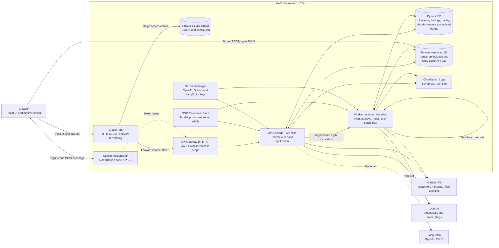
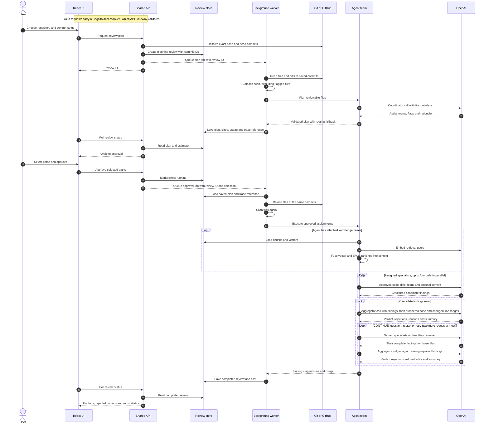
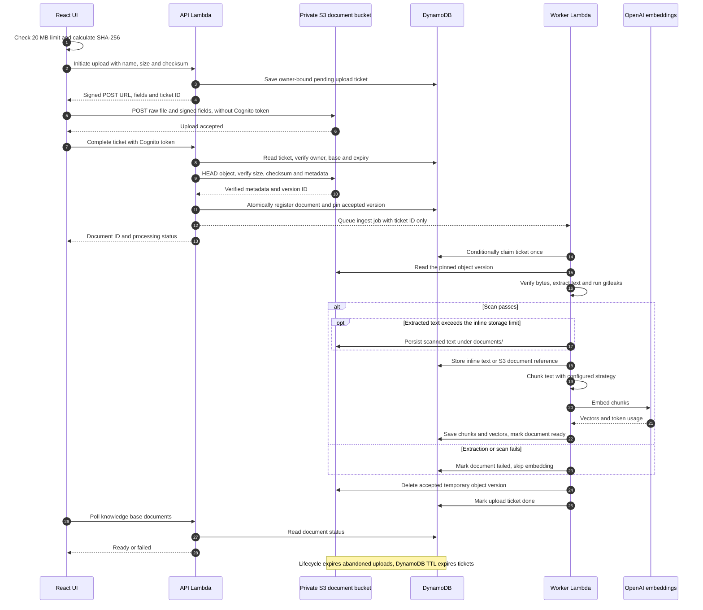

# Review Crew

**A team of AI agents that reviews your git commits, locally or on AWS.** A coordinator routes changed files to language and framework specialists, an aggregator checks every finding against the code, and nothing reaches a model until you approve the files and the cost.

<table><tr>
<td align="center"><a href="frontend/src/docs/review.webm"></a><br><b>Running a review</b></td>
<td align="center"><a href="frontend/src/docs/agents.webm"></a><br><b>Configuring agents</b></td>
<td align="center"><a href="frontend/src/docs/knowledge.webm"></a><br><b>Knowledge bases (RAG)</b></td>
</tr></table>

<sub>Click a preview to play it. Recorded with Playwright against a demo repository and a scripted model.</sub>

## Highlights

- **Agent team:** Python, JavaScript, TypeScript, Java, Go, C# and a general specialist review in parallel. Angular and React files also get a framework specialist.
- **Aggregation gate:** the aggregator judges findings against numbered code, rejects weak ones with reasons, and can question, restart or retry a specialist for up to three rounds.
- **Approval and budget:** rules flag low-value files, you pick files and approve an "at most" cost, and that budget is enforced while the review runs.
- **Context on demand:** specialists and the aggregator can request unchanged files, which are read at the head commit and Gitleaks-scanned, within a quota.
- **Secure by default:** only committed code is reviewed, every payload is Gitleaks-scanned, and the store keeps findings, not source.
- **RAG knowledge bases:** structure-aware chunking with hybrid vector and BM25 retrieval fused by RRF, attachable per agent.
- **Everywhere you look:** live agent activity, a review UI, a CLI, SARIF export, a chat agent over review history, and optional LangSmith traces.
- **Two modes, one codebase:** SQLite and threads locally, or Lambda, DynamoDB, S3, CloudFront and Cognito on AWS.

## Architecture

### Agent team

LangGraph runs a coordinator graph, then (after approval) a review graph that fans out to specialists and loops back through the aggregator. All agents share one worker invocation by design ([decision 1](docs/decisions/0001-agents-in-one-lambda.md)).



### Deployment



### Review data flow



### Knowledge upload data flow



## Quick start

```sh
brew install gitleaks
export OPENAI_API_KEY=...
pip install -e .            # add '.[pdf]' for PDF knowledge uploads
autosde serve               # http://127.0.0.1:8765/
```

From the command line:

```sh
autosde review ~/code/shop main..HEAD             # plan, approve, review
autosde show 3 --format sarif --output out.sarif  # export findings
```

## Configuration

| Variable | Purpose |
| --- | --- |
| `OPENAI_API_KEY` | Model and embedding calls (never stored) |
| `AUTOSDE_MODEL`, `AUTOSDE_INPUT_PRICE`, `AUTOSDE_OUTPUT_PRICE` | Default model and prices for estimates |
| `AUTOSDE_HOME` | Data folder (default `~/.autosde`) |
| `AUTOSDE_GITLEAKS` | Gitleaks binary (default: on `PATH`) |
| `LANGSMITH_API_KEY` | Optional tracing |

Per-agent models, prompts, extensions, retry limits and knowledge bases are set on the **Agents** page.

## Developing

```sh
pip install -e ".[dev]"
AUTOSDE_GITLEAKS="$(command -v gitleaks)" python3 -m unittest discover -s tests -t tests
cd frontend && npm install && npm run build   # writes autosde/static/
npm run record-docs -- --gitleaks "$(command -v gitleaks)"   # re-record the videos
```

More: [RAG](docs/RAG.md) · [AWS deployment](docs/aws/DEPLOYMENT.md) · [Frontend config](docs/aws/FRONTEND.md) · [Infrastructure](infrastructure/)

## Built with

<p align="center">
<a href="https://github.com/python/cpython"></a>
<a href="https://github.com/langchain-ai/langgraph"></a>
<a href="https://github.com/langchain-ai/langsmith-sdk"></a>
<a href="https://github.com/openai/openai-python"></a>
<a href="https://github.com/gitleaks/gitleaks"></a>
<a href="https://github.com/facebook/react"></a>
<a href="https://github.com/vitejs/vite"></a>
<a href="https://github.com/microsoft/playwright"></a>
<a href="https://github.com/sqlite/sqlite"></a>
<a href="https://github.com/aws/aws-cdk"></a>
<a href="https://github.com/microsoft/TypeScript"></a>
<a href="https://github.com/boto/boto3"></a>
<a href="https://github.com/getmoto/moto"></a>
<a href="https://github.com/py-pdf/pypdf"></a>
<a href="https://github.com/mermaid-js/mermaid"></a>
</p>
